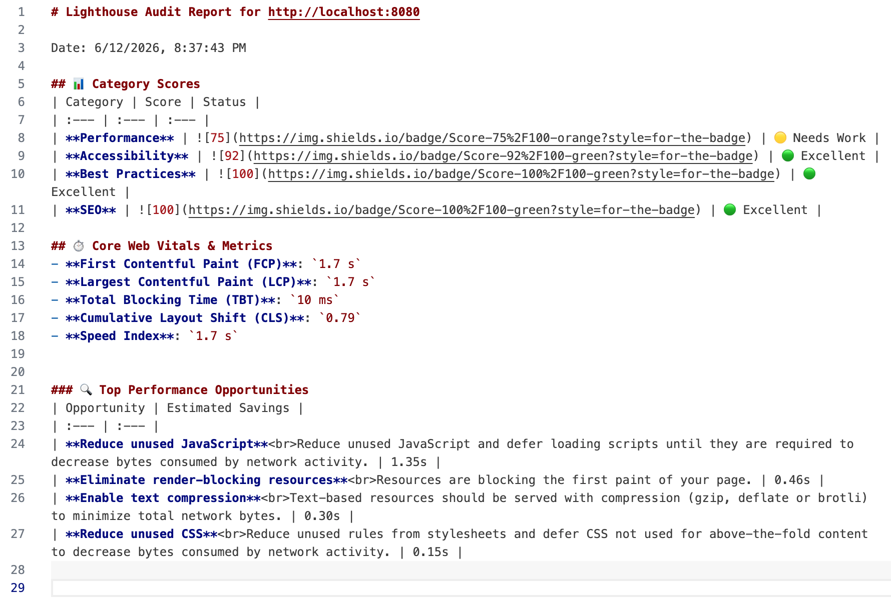
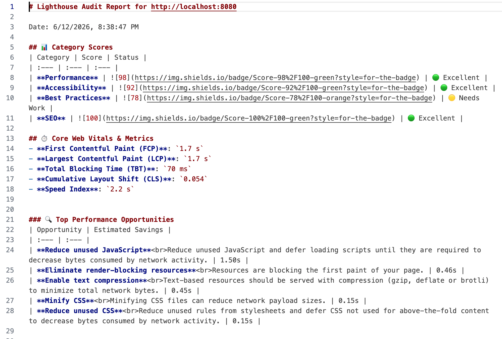

# ⚡ lighthouse-performance-skills

[](https://opensource.org/licenses/MIT)
[](http://makeapullrequest.com)
[](https://github.com/your-username/lighthouse-performance-skills)

> **面向 AI 编码助手（如 Antigravity、Cursor、Claude Code）的网页性能诊断与极致优化 Skill 插件包。让 AI 代理全自动分析你的网页，并将 Lighthouse 跑分飙升至 95+！**

[English README](./README.md) | 中文说明文档

---

## 📸 优化效果展示 (Before vs. After)

| 优化前 (CLS: 0.79, 跑分: 75 🟡) | 优化后 (CLS: 0.054, 跑分: 98 🟢) |
| :---: | :---: |
|  |  |

---

## 💡 为什么需要这个项目？

随着 Cursor 和 Claude Code 等 AI 编码工具的普及，我们开始把重构、编码任务交给 AI。但是，**网页性能优化（Web Performance Optimization）** 是一个高度复杂的系统工程，直接让 AI 优化，它常常会：
- 🔴 盲目压缩图片导致 UI 模糊、质感全无。
- 🔴 漏掉关键渲染路径（Critical Path）导致白屏时间延长。
- 🔴 因不了解 Core Web Vitals（如 LCP, INP, CLS）而改出大量布局抖动。

**`lighthouse-performance-skills`** 正是为解决这一痛点而生！它通过规范化的 **`SKILL.md` 指令集** 与 **配套 Node.js 脚本工具**，为您的 AI 编码代理提供了一套可执行的性能诊断与优化标准工作流，让 AI 真正懂得如何科学、安全、优雅地做前端性能优化。

---

## ✨ 核心特性

- 📊 **一键无头审计**：集成 `Lighthouse` 引擎，自动启动 Headless Chrome 运行审计，生成包含关键指标（LCP, CLS, TBT）的 Markdown 简报。
- 🖼️ **智能图像优化**：利用 `sharp` 库进行高质量的图片有损/无损压缩，并全自动生成 WebP 格式，保留 UI 极致的高级感。
- 🤖 **Agent 原生友好**：内置专为 AI 设计的 `SKILL.md` 指令，适配主流 AI 编辑器的自定义规则系统。
- 📈 **闭环验证**：指导 AI 建立“审计基线 -> 实施优化 -> 二次审计对比”的闭环，确保优化效果通过数据说话。

---

## 📂 目录结构

```text
lighthouse-performance-skills/
├── SKILL.md                  # AI Agent 的核心执行指令文件（核心）
├── package.json              # 项目依赖与运行脚本
├── README.md                 # 项目介绍 (英文)
├── README_ZH.md              # 项目介绍 (中文)
└── scripts/
    ├── run-lighthouse.js     # 用于审计本地/远程网页性能的脚本
    └── optimize-images.js    # 自动执行图像转换与优化的脚本
```

---

## 🚀 快速开始

### 1. 克隆与安装依赖

首先克隆本项目或将此 Skill 文件夹放入您的项目中，并安装依赖：

```bash
cd lighthouse-performance-skills
npm install
```

> **注意**：运行 Lighthouse 审计脚本需要系统已安装 **Google Chrome** 或 **Chromium** 浏览器。

### 🛠️ 常见问题（Sharp 库安装失败提示）

如果您在运行 `npm install` 时遇到与 `sharp` 相关的安装警告或权限报错（例如 `npm warn allow-scripts sharp@0.33.x`），这通常是由于系统或网络策略限制了 Node 的原生编译和脚本下载。您可以通过以下命令尝试解决：
```bash
npm config set ignore-scripts false
npm install
```
或者手动批准该包的底层运行脚本：
```bash
npm approve-scripts sharp
```

### 2. 试用 Demo (1分钟极速上手体验)

您可以直接使用项目中自带的 `/example` 演示页面来体验审计与优化工作流：

1. 启动本地静态服务器托管 demo 网页：
   ```bash
   npx http-server ./example -p 8080
   ```
2. 在另一个终端窗口运行性能审计脚本：
   ```bash
   npm run audit -- --url http://localhost:8080 --output reports/demo-report.json
   ```
   *这将在 `reports/` 目录下导出 `demo-report.json`、`demo-report.md` 简报以及可在浏览器中直接打开的交互式 `demo-report.html`。*
3. 一键优化 Demo 中未压缩的大图：
   ```bash
   npm run optimize -- --dir ./example/images --quality 80
   ```

### 3. 独立运行脚本工具

虽然这些工具是设计给 AI 调用的，您也可以手动运行它们：

#### 🏃‍♂️ 运行性能诊断
```bash
# 对本地开发服务器或在线网站运行性能审计
npm run audit -- --url http://localhost:3000 --output reports/baseline.json
```
运行后会在控制台打印漂亮的跑分摘要，并在 `reports/` 目录下生成 `baseline.json`（详细数据）和 `baseline.md`（Markdown版简报）。

#### 🖼️ 批量优化图片
```bash
# 扫描指定目录下的图片，进行压缩并自动生成对应的 .webp 格式
npm run optimize -- --dir ./public/assets/images --quality 80
```

---

## 🤖 如何导入到您的 AI 编码助手？

### 1. 在 Antigravity 中使用
将该目录放入您的项目根目录中。当您对 Antigravity 提出类似“优化我们网站的加载速度”或“提高 Lighthouse 分数”的要求时，Antigravity 会自动读取并执行 `SKILL.md` 中定义的标准步骤。

### 2. 在 Cursor 中使用 (.cursorrules)
在您的项目根目录下创建 `.cursorrules` 文件，并将 `SKILL.md` 的内容或引用加入其中：
```markdown
对于任何关于性能优化的需求，请严格参考 lighthouse-performance-skills/SKILL.md 中定义的工作流：
1. 运行 node scripts/run-lighthouse.js 建立跑分基线。
2. 运行 node scripts/optimize-images.js 优化媒体资源。
3. 执行代码级优化（延迟加载、代码分割、优化 CLS）。
4. 重新审计并输出前后跑分对比表格。
```

### 3. 在 Claude Code 中使用
在与 Claude CLI 交互时，您可以直接将本项目的 `SKILL.md` 作为上下文输入：
```bash
claude "阅读 lighthouse-performance-skills/SKILL.md，并帮我优化当前项目的性能"
```

---

## 🛡️ 开源协议

本项目采用 [MIT License](LICENSE) 开源协议。

---

## 🌟 欢迎 Star & 提交 PR！

如果您觉得这个 Skill 帮您或您的 AI 助手节省了时间，欢迎点一个 **Star** 🌟！ 
如果您有更好的优化脚本、指令建议，非常欢迎提交 Pull Request，让我们一起完善它！
