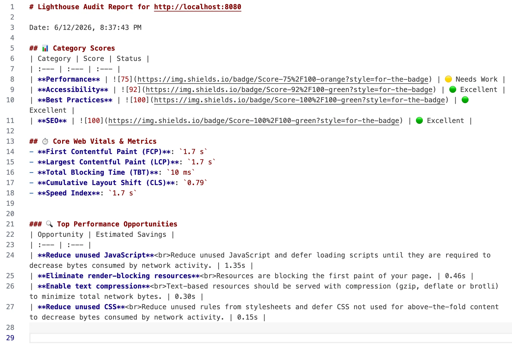
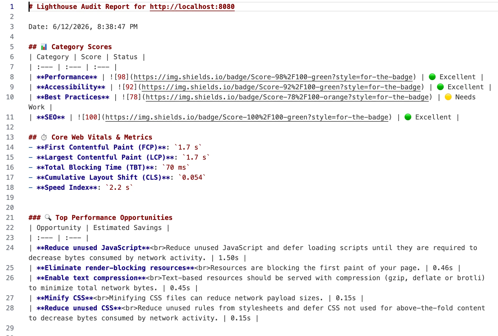

# ⚡ lighthouse-performance-skills

[](https://opensource.org/licenses/MIT)
[](http://makeapullrequest.com)
[](https://github.com/HenryYannis/lighthouse-performance-skills)

> **面向 AI 编码助手（如 Antigravity、Cursor、Claude Code）的网页性能诊断与极致优化 Skill 插件包。让 AI 代理全自动分析你的网页，并将 Lighthouse 跑分飙升至 95+！**

[English README](./README.md) | 中文说明文档

---

## 📸 优化效果展示 (Before vs. After)

| 优化前 (CLS: 0.79, 跑分: 75 🟡) | 优化后 (CLS: 0.054, 跑分: 98 🟢) |
| :---: | :---: |
|  |  |

---

## 💡 为什么需要这个项目？

随着 Cursor 和 Claude Code 等 AI 编码工具的普及，我们开始把重构、编码任务交给 AI。但是，**网页性能优化（Web Performance Optimization）** 是一个高度复杂的系统工程，直接让 AI 优化，它常常会：
- 🔴 盲目压缩图片导致 UI 模糊、质感全无。
- 🔴 漏掉关键渲染路径（Critical Path）导致白屏时间延长。
- 🔴 因不了解 Core Web Vitals（如 LCP, INP, CLS）而改出大量布局抖动。

**`lighthouse-performance-skills`** 正是为解决这一痛点而生！它通过规范化的 **`SKILL.md` 指令集** 与 **配套 Node.js 脚本工具**，为您的 AI 编码代理提供了一套可执行的性能诊断与优化标准工作流，让 AI 真正懂得如何科学、安全、优雅地做前端性能优化。

---

## ✨ 核心特性

- 📊 **一键无头审计**：集成 `Lighthouse` 引擎，自动启动 Headless Chrome 运行审计，生成包含关键指标（LCP, CLS, TBT）的 Markdown 简报。
- 🖼️ **智能图像优化**：利用 `sharp` 库生成 WebP（可选 AVIF）格式。默认不动原图，也不动已存在的 `.webp`/`.avif`，只有明确要求时才处理（`--out` 输出到单独目录，`--in-place` 覆盖并保留 `.orig` 备份，`--force` 覆盖已有的 WebP/AVIF）。JPEG 用 mozjpeg 有损压缩，PNG 默认无损。
- 🤖 **Agent 原生友好**：内置专为 AI 设计的 `SKILL.md` 指令，适配主流 AI 编辑器的自定义规则系统。
- 📈 **闭环验证**：指导 AI 建立“审计基线 -> 实施优化 -> 二次审计对比”的闭环，确保优化效果通过数据说话。

---

## 📂 目录结构

```text
lighthouse-performance-skills/
├── skills/
│   └── lighthouse-performance-skills/
│       └── SKILL.md          # Agent Skill 指令文件（唯一来源）
├── rules/
│   └── lighthouse-performance.mdc # Cursor 规则，由 SKILL.md 自动生成
├── bin/
│   └── cli.js                # `lighthouse-performance-skills audit|optimize` 命令入口
├── package.json              # 项目依赖与运行脚本
├── README.md                 # 项目介绍 (英文)
├── README_ZH.md              # 项目介绍 (中文)
└── scripts/
    ├── run-lighthouse.js     # 用于审计本地/远程网页性能的脚本
    ├── optimize-images.js    # 生成 WebP/AVIF、压缩图片的脚本
    └── sync-rules.js         # 从 SKILL.md 重新生成 Cursor 规则
```

---

## 🚀 快速开始

### 1. 克隆与安装依赖

首先克隆本项目或将此 Skill 文件夹放入您的项目中，并安装依赖：

```bash
cd lighthouse-performance-skills
npm install
```

> **注意**：需要 **Node.js 22.19+**（Lighthouse 13 的要求）；运行审计脚本还需要系统已安装 **Google Chrome** 或 **Chromium** 浏览器。Chrome 沙箱默认开启，只有以 root 运行（如 Docker）、在 CI 中（`CI=true`）或设置 `LH_NO_SANDBOX=1` 时才关闭。

### 🛠️ 常见问题（Sharp 库安装失败提示）

如果看到 `npm warn allow-scripts sharp@...` 这样的提示，这是 npm 自己的机制：较新的 npm（11.16+ / 12）默认拦截依赖包的安装脚本，需要先批准，和 `ignore-scripts` 设置无关。

- 克隆本仓库后，在项目目录里批准一次 sharp，再重新安装：
  ```bash
  npm approve-scripts sharp
  npm install
  ```
- 通过 `npx` 运行时（没有项目 `package.json` 可以记录批准），改用参数。`--allow-remote=all` 是给 npm 12 的：它默认拒绝从网址下载的包，旧版 npm 会忽略这个参数：
  ```bash
  npx -y --allow-remote=all --allow-scripts=sharp https://codeload.github.com/HenryYannis/lighthouse-performance-skills/tar.gz/14cb046376d37d5c44cbddd22cb52a42da527ae5 optimize --dir ./public/images
  ```

### 2. 试用 Demo (1分钟极速上手体验)

您可以直接使用项目中自带的 `/example` 演示页面来体验审计与优化工作流：

1. 启动本地静态服务器托管 demo 网页：
   ```bash
   npx http-server ./example -p 8080
   ```
2. 在另一个终端窗口运行性能审计脚本：
   ```bash
   npm run audit -- --url http://localhost:8080 --output reports/demo-report.json
   ```
   *这将在 `reports/` 目录下导出 `demo-report.json`、`demo-report.md` 简报以及可在浏览器中直接打开的交互式 `demo-report.html`。*
3. 一键优化 Demo 中未压缩的大图（会在旁边生成 `large-photo.webp`，原 JPG 不动）：
   ```bash
   npm run optimize -- --dir ./example/images --quality 80
   ```

### 3. 独立运行脚本工具

虽然这些工具是设计给 AI 调用的，您也可以手动运行它们：

#### 🏃‍♂️ 运行性能诊断
```bash
# 对本地开发服务器或在线网站运行性能审计
npm run audit -- --url http://localhost:3000 --output reports/baseline.json
```
运行后会在控制台打印漂亮的跑分摘要，并在 `reports/` 目录下生成 `baseline.json`（详细数据）、`baseline.html`（交互式报告）和 `baseline.md`（Markdown 版简报）。

| 参数 | 默认值 | 说明 |
| :--- | :--- | :--- |
| `--url` | `https://example.com` | 要审计的网页 |
| `--output` | `reports/performance-report.json` | 报告路径，`.json`/`.html`/`.md` 会并排生成（扩展名可省略） |
| `--runs` | `3` | 运行次数，取中位数那一次；单次跑分常有 ±5 分波动 |
| `--preset` | `mobile` | `mobile` 或 `desktop` |

#### 🖼️ 批量优化图片
```bash
# 在原图旁边生成 .webp（原图不动）
npm run optimize -- --dir ./public/assets/images --quality 80

# 同时把压缩后的原格式图片写到单独目录
npm run optimize -- --dir ./public/assets/images --out ./public/assets/images-optimized

# 直接覆盖原图（先备份成 .orig，下次运行会跳过已处理的文件）
npm run optimize -- --dir ./public/assets/images --in-place
```

| 参数 | 说明 |
| :--- | :--- |
| `--dir` | 要扫描的图片目录（默认 `./images`），其中的符号链接会跳过 |
| `--quality` | 有损压缩质量，1 到 100 的整数，默认 `80` |
| `--out <dir>` | 把压缩后的原格式和 WebP/AVIF 按原目录结构写到这个目录；压不小的原图和已有的 `.webp` 原样拷过去 |
| `--in-place` | 覆盖原图，覆盖前把每个文件备份成 `<文件名>.orig`（中途换了新图会另存为 `.orig.2`、`.orig.3`……，旧备份绝不覆盖） |
| `--force` | 覆盖已存在的 `.webp`/`.avif`（默认保留不动）；配合 `--in-place` 时重新处理 `.optimize-images-manifest.json` 里已记录的文件 |
| `--avif` | 同时生成 AVIF |
| `--png-palette` | 把 PNG 量化成 256 色（有损）；PNG 默认无损 |
| `--webp-only` | 只生成现代格式，不压缩原图 |

#### 📦 不克隆也能用
两个工具都可以作为命令在任何目录下运行：
命令固定到了某一个提交（`…/tar.gz/14cb046…`），`npx` 每次运行的都是可以审查的那份代码，而不是 `main` 上最新的代码。要升级，把这串哈希换成本仓库更新的提交即可。（命令下载的是该提交的压缩包，而不是用 `github:` 写法，因为 npm 10 的 `npx` 无法拉取固定到某个提交的 `github:` 地址。）
```bash
npx -y --allow-remote=all --allow-scripts=sharp https://codeload.github.com/HenryYannis/lighthouse-performance-skills/tar.gz/14cb046376d37d5c44cbddd22cb52a42da527ae5 audit --url http://localhost:3000 --output reports/baseline.json
npx -y --allow-remote=all --allow-scripts=sharp https://codeload.github.com/HenryYannis/lighthouse-performance-skills/tar.gz/14cb046376d37d5c44cbddd22cb52a42da527ae5 optimize --dir ./public/assets/images
```

---

## 🤖 如何导入到您的 AI 编码助手？

### 1. 在 Antigravity 中使用
将该目录放入您的项目根目录中。当您对 Antigravity 提出类似“优化我们网站的加载速度”或“提高 Lighthouse 分数”的要求时，Antigravity 会自动读取并执行 `skills/lighthouse-performance-skills/SKILL.md` 中定义的标准步骤。

### 2. 在 Cursor 中使用 (.cursorrules & .mdc)
将 `rules/lighthouse-performance.mdc` 复制到您项目的 `.cursor/rules/` 目录下即可。这条规则是 `alwaysApply: false`，Cursor 的 Agent 只会在任务和规则描述相关时才加载它。您也可以在 `.cursorrules` 文件中添加以下规则引用：
```markdown
对于任何网页性能优化任务，请严格执行以下工作流：
1. 运行 `npx -y --allow-remote=all --allow-scripts=sharp https://codeload.github.com/HenryYannis/lighthouse-performance-skills/tar.gz/14cb046376d37d5c44cbddd22cb52a42da527ae5 audit --url <网址> --output reports/baseline.json` 建立跑分基线。
2. 运行 `npx -y --allow-remote=all --allow-scripts=sharp https://codeload.github.com/HenryYannis/lighthouse-performance-skills/tar.gz/14cb046376d37d5c44cbddd22cb52a42da527ae5 optimize --dir <图片目录>` 优化媒体资源。
3. 执行代码级优化（延迟加载、代码分割、优化 CLS）。
4. 重新审计并输出前后跑分对比表格。
```

### 3. 在 Claude Code 中使用
把 skill 文件夹安装成 Claude Code 的 skill，可以对所有项目生效，也可以只对单个项目生效：
```bash
# 所有项目
mkdir -p ~/.claude/skills && cp -r skills/lighthouse-performance-skills ~/.claude/skills/
# 或者只对当前项目
mkdir -p .claude/skills && cp -r /path/to/lighthouse-performance-skills/skills/lighthouse-performance-skills .claude/skills/
```
之后当您让 Claude Code 优化网页速度或提高 Lighthouse 分数时，它会根据 `SKILL.md` 里的 `description` 自动使用这个 skill，不需要每次手动让它阅读文件。只安装了 skill 文件夹时，skill 会通过 `npx -y --allow-remote=all --allow-scripts=sharp https://codeload.github.com/HenryYannis/lighthouse-performance-skills/tar.gz/14cb046376d37d5c44cbddd22cb52a42da527ae5` 调用配套脚本。

> **修改指令**：`SKILL.md` 是唯一来源，改完后运行 `node scripts/sync-rules.js` 重新生成 Cursor 规则。

---

## 🛡️ 开源协议

本项目采用 [MIT License](LICENSE) 开源协议。

---

## 🌟 欢迎 Star & 提交 PR！

如果您觉得这个 Skill 帮您或您的 AI 助手节省了时间，欢迎点一个 **Star** 🌟！ 
如果您有更好的优化脚本、指令建议，非常欢迎提交 Pull Request，让我们一起完善它！
